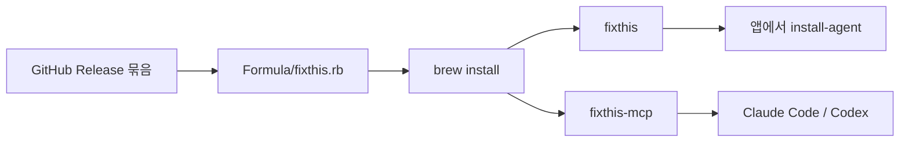

# beyondwin/tools

macOS에서 [FixThis](https://github.com/beyondwin/FixThis) CLI를 설치하는 Homebrew 탭입니다.

이 저장소는 **설치 레시피**만 담습니다. 앱 소스, Gradle 플러그인, 샘플 앱은 [FixThis](https://github.com/beyondwin/FixThis)에 있습니다.

## 설치

```bash
brew install beyondwin/tools/fixthis
```

이미 설치돼 있으면:

```bash
brew update && brew upgrade beyondwin/tools/fixthis
fixthis --version
```

필요 조건: macOS, Homebrew, JDK 21 (`openjdk@21`을 같이 설치합니다).

## 설치 후

Compose Android 앱 저장소에서 에이전트 설정을 붙입니다.

```bash
fixthis install-agent --project-dir . --target all --verify --json
```

제품 사용법: [FixThis README](https://github.com/beyondwin/FixThis#readme)

## 무엇이 설치되나

| 명령 | 역할 |
| --- | --- |
| `fixthis` | CLI. 앱에 플러그인을 붙이고, 상태를 보고, 콘솔을 엽니다. |
| `fixthis-mcp` | 로컬 MCP 서버. Claude Code / Codex가 붙는 쪽입니다. |

둘은 한 묶음으로 설치됩니다. CLI가 MCP 서버를 옆에서 찾기 때문입니다.

이 탭이 **설치하지 않는 것**: Gradle 플러그인, Maven 라이브러리, 샘플 앱, npm 패키지.

다른 설치 경로(npm, GitHub Release): [FixThis 설치](https://github.com/beyondwin/FixThis#quick-start-agent-installs-fixthis-in-your-app)

## 구조



| 경로 | 하는 일 |
| --- | --- |
| `Formula/fixthis.rb` | 배포 묶음 URL, 체크섬, JDK 21, 실행 파일 연결 |
| [FixThis](https://github.com/beyondwin/FixThis) | 제품 코드, 문서, 릴리스 |

탭 이름은 `beyondwin/tools`입니다. `brew tap beyondwin/tools` 후 `brew install fixthis`도 같은 패키지를 설치합니다.

## 업그레이드 / 제거

```bash
brew update
brew upgrade beyondwin/tools/fixthis
brew uninstall fixthis
```

탭 자체를 빼려면 `brew untap beyondwin/tools`.

## 버전 올리기

1. [FixThis Release](https://github.com/beyondwin/FixThis/releases)에 `fixthis-cli-mcp-vX.Y.Z.tar.gz`와 `.sha256`이 공개됐는지 확인합니다.
2. `Formula/fixthis.rb`의 `url`과 `sha256`만 그 릴리스에 맞춥니다.
3. 확인:

   ```bash
   brew style Formula/fixthis.rb
   brew audit --strict --online beyondwin/tools/fixthis
   brew livecheck --formula beyondwin/tools/fixthis
   ```

   `audit` / `livecheck`는 Homebrew 탭 클론(`brew --repo beyondwin/tools`)을 읽습니다. 이 저장소가 그 경로가 아니면 푸시한 뒤 `brew update` 하고 검수하세요.

제품 문서, CLI 동작, Gradle 플러그인은 이 저장소에서 고치지 않습니다.

`main` push와 pull request에서 Homebrew `test-bot`이 탭 문법과 `fixthis` 설치·테스트를 돌립니다.

## 라이선스

[MIT](LICENSE). 설치되는 FixThis 바이너리도 MIT입니다.
